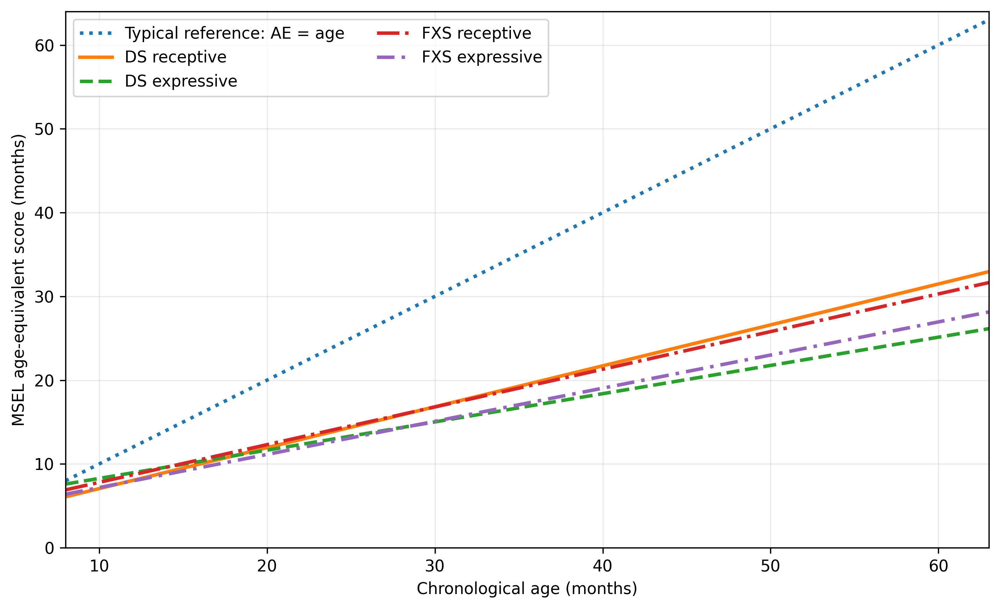
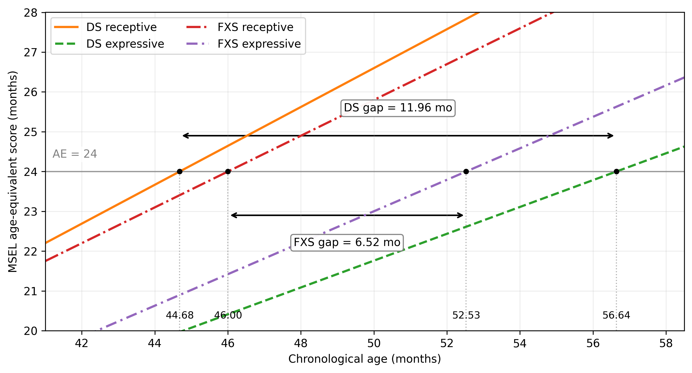

# One Gap, Three Answers

## A Calculus Analysis of Receptive and Expressive Language Development

[](https://github.com/nicolerollo/receptive-expressive-gap-calculus/actions/workflows/reproducibility.yml)

[](LICENSE)
[](LICENSE-CONTENT.md)
[](paper/one-gap-three-answers.pdf)

**Nicole Rollo** · MATH 140: Calculus I · University of Maryland Global Campus · 2026

Receptive language concerns what a child understands; expressive language concerns what a child can communicate. When those trajectories differ, the size of the developmental "gap" depends on what is meant mathematically by *gap*.

This repository reproduces a Calculus I analysis of group-level receptive- and expressive-language trajectories in **Down syndrome (DS)** and **Fragile X syndrome (FXS)**. The same fitted trajectories are examined with three valid definitions of separation:

$$
G(t)=R(t)-E(t)
$$

an **absolute score gap** at the same chronological age,

$$
Q(t)=\frac{R(t)}{E(t)}
$$

a **proportional gap**, and

$$
H(A)=t_E(A)-t_R(A)
$$

a **chronological time gap** between the receptive and expressive trajectories reaching the same numerical age-equivalent score.

> **Central takeaway:** The same developmental data can support several mathematically correct descriptions, but each answers a different question. How the gap is defined determines what part of the developmental relationship becomes visible.



## Research question

The project asks how the receptive-expressive relationship changes over early development, and then asks a more fundamental measurement question: **if the same pair of developmental trajectories can be separated in several mathematically valid ways, what does each definition actually measure?**

The analysis uses linear functions so that differentiation, inverse functions, the quotient rule, and the Mean Value Theorem can be used to compare the three definitions directly.

## Developmental models and provenance

The models are based on published **Mullen Scales of Early Learning (MSEL)** age-equivalent (AE) results. An AE score is a derived test-score quantity: an AE of 24 means that a raw subscale score corresponds approximately to the score associated with 24 months in the normative sample. It should **not** be interpreted as meaning that every aspect of a child's language is literally at a 24-month developmental level.

### Down syndrome

The DS models used in the final paper are

$$
R_{DS}(t)=0.48845t+2.176
$$

$$
E_{DS}(t)=0.33714t+4.904.
$$

These equations are **approximate project models**, not coefficients directly reported by D'Souza et al. (2026). The receptive and expressive slopes were estimated from the cross-sectional trajectories in their Figure 2. The intercepts were then derived by anchoring those slopes to the Time 1 group means in their Table 2 at mean chronological age 27.81 months: receptive-language AE = 15.76 months and expressive-language AE = 14.28 months.

The repository reconstructs this calculation from `data/ds_model_inputs.csv` rather than treating the final intercepts as unexplained constants.

### Fragile X syndrome

The FXS models are ordinary least-squares fits to the seven age-cluster means reported in Table II of Roberts et al. (2009), using the nominal cluster ages as the independent variable. The code computes the regression coefficients from `data/fxs_roberts2009_tableII.csv`; long coefficients are not hard-coded.

The fitted equations, rounded for display, are

$$
R_{FXS}(t)\approx0.44977t+3.30959
$$

$$
E_{FXS}(t)\approx0.39539t+3.23195.
$$

Calculations retain the unrounded OLS coefficients, matching the final analysis. Because the published age clusters cover ranges rather than single exact ages, these models approximate the reported group trend and are **not** reproductions of the authors' hierarchical linear models.

### Typical-development reference

The line

$$
R_{TD}(t)=E_{TD}(t)=t
$$

is a normalized reference used for interpretation. It is not a separate empirical control dataset.

## Three measures, three questions

### 1. Absolute score gap

$$
G(t)=R(t)-E(t)
$$

This asks: **At the same chronological age, how many AE-score months separate the fitted receptive and expressive trajectories?**

For the fitted linear models,

$$
G'_{DS}(t)=0.15131
$$

and

$$
G'_{FXS}(t)\approx0.05438.
$$

Both fitted gap functions increase with age, and the DS gap increases faster. The DS fitted difference changes sign near 18.03 months rather than being positive over the entire modeled interval.

### 2. Proportional gap

$$
Q(t)=\frac{R(t)}{E(t)}=1+\frac{G(t)}{E(t)}.
$$

This asks: **How large is the receptive score relative to the expressive score?**

For linear trajectories, the quotient rule gives

$$
Q'(t)=\frac{m_Rb_E-b_Rm_E}{(m_Et+b_E)^2}.
$$

The numerator is positive in both fitted models, so the proportional receptive advantage increases wherever the expressive trajectory is positive.

### 3. Chronological time gap

For a common numerical AE target $`A`$, define

$$
t_R(A)=R^{-1}(A),\qquad t_E(A)=E^{-1}(A),
$$

and

$$
H(A)=t_E(A)-t_R(A).
$$

This asks: **How much chronological time separates the receptive and expressive trajectories from reaching the same numerical score?**

The Mean Value Theorem connects the time gap to the score gap. For continuous, differentiable, strictly increasing trajectories with $`E'(t)>0`$, there is some $`c`$ between the two attainment times such that

$$
H(A)=\frac{G(t_R(A))}{E'(c)}.
$$

For the linear models in this project, $`E'(t)=m_E`$ everywhere, so

$$
H(A)=\frac{G(t_R(A))}{m_E}.
$$

This makes the interpretation explicit: **time separation depends on both score separation and expressive rate of change.**

## Worked comparison at AE = 24

At the chronological age when the receptive trajectory reaches AE = 24, the three measures give:

| Measure | Down syndrome | Fragile X syndrome |
|---|---:|---:|
| Chronological age at receptive AE = 24 | 44.68 mo | 46.00 mo |
| Absolute score gap, $`G`$ | 4.03 AE mo | 2.58 AE mo |
| Proportional excess, $`Q-1`$ | 20.2% | 12.0% |
| Chronological time gap, $`H`$ | 11.96 mo | 6.52 mo |

The modeled DS/FXS ratio is therefore about 1.56 by absolute score, 1.68 by proportional excess, and 1.83 by chronological time. All three are mathematically valid; they emphasize different properties of the same fitted trajectories.



## When correct measures disagree

The distinction is not merely semantic. The two modeled comparisons reverse ordering over a narrow interval:

- the **time-gap** comparison switches at approximately **26.63 months**;
- the **absolute score-gap** comparison switches at approximately **28.94 months**.

Here each group's time gap is evaluated at its own receptive score $`A=R(t)`$, so $`H(R(t))=G(t)/m_E`$.

Between about 26.6 and 28.9 months, the absolute score measure identifies the modeled FXS separation as larger, while the chronological time measure identifies the modeled DS separation as larger.

This is a **mathematical proof of concept**, not a clinical ranking of DS and FXS. The models were constructed from separate studies, use group-level summaries, and include approximation choices.

## Reproducibility

A GitHub Actions workflow (`.github/workflows/reproducibility.yml`) runs the regression tests, numerical analysis, and both figure-generation scripts on pushes and pull requests.

The analysis has two runtime dependencies: NumPy and Matplotlib. The checked repository snapshot was verified with Python 3.13.5, NumPy 2.3.5, and Matplotlib 3.10.8.

Create an environment if desired, install the dependencies, and run:

```bash
python -m pip install -r requirements.txt
python src/analysis.py
python src/figure1_trajectories.py
python src/figure2_time_gap.py
python -m unittest discover -s tests -v
```

`src/models.py` is the shared source of model construction. Both figures and the numerical analysis use the same model objects. The FXS OLS coefficients are recomputed from the published aggregate inputs each run, and the DS intercepts are reconstructed from the documented slope estimates and published Table 2 anchors.

The regression test suite verifies the fitted coefficients, gap derivatives, proportional-gap derivative terms, AE = 24 example, linear Mean Value Theorem identity, and both crossover ages. During repository preparation, the regenerated figure PNGs also matched the PNGs embedded in the final DOCX byte-for-byte in the verified environment.

## Repository structure

```text
.
├── README.md
├── CITATION.cff
├── LICENSE
├── LICENSE-CONTENT.md
├── requirements.txt
├── .gitignore
├── .github/
│   └── workflows/
│       └── reproducibility.yml
├── data/
│   ├── README.md
│   ├── ds_model_inputs.csv
│   └── fxs_roberts2009_tableII.csv
├── figures/
│   ├── figure1_clean_trajectories.png
│   └── figure2_time_gap_example.png
├── paper/
│   ├── README.md
│   └── one-gap-three-answers.pdf
├── src/
│   ├── analysis.py
│   ├── figure1_trajectories.py
│   ├── figure2_time_gap.py
│   └── models.py
└── tests/
    └── test_reproduction.py
```

## Interpretation and limitations

This repository is intentionally narrow. It documents exactly what the Calculus I project did; it is not a broader psychometrics or neurodevelopmental analysis.

- The models describe **group-level published trends**, not individual children.
- The DS slopes were estimated from a published figure and are therefore approximate.
- The FXS regressions use published age-cluster means and nominal cluster ages.
- The source studies are independent datasets with different samples and study designs.
- AE scores are derived test-score quantities and should not be treated as literal developmental ages across all aspects of language.
- The narrow crossover interval demonstrates measurement dependence; it should not be used to rank clinical severity between conditions.
- No causal claims are made.

## Source studies

D'Souza, H., Karmiloff-Smith, A., Mareschal, D., & Thomas, M. S. C. (2026). *The Down syndrome profile emerges gradually across early development*. **Journal of Applied Research in Intellectual Disabilities, 39**(4), Article e70218. https://doi.org/10.1111/jar.70218

Roberts, J. E., Mankowski, J. B., Sideris, J., Goldman, B. D., Hatton, D. D., Mirrett, P. L., Baranek, G. T., Reznick, J. S., Long, A. C. J., & Bailey, D. B., Jr. (2009). *Trajectories and predictors of the development of very young boys with fragile X syndrome*. **Journal of Pediatric Psychology, 34**(8), 827-836. https://doi.org/10.1093/jpepsy/jsn129

Copies of the source articles are **not** included in this repository. Only the small set of published aggregate values required to reproduce the FXS modeling, together with documented DS model inputs, are retained here with explicit provenance.

## Project context

This analysis was originally developed by **Nicole Rollo** as the final project for **MATH 140: Calculus I** at the University of Maryland Global Campus. The public repository refactors the original appendix scripts into a shared, reproducible analysis without changing the mathematics or conclusions of the final paper.

## License and citation

Original Python code in this repository is licensed under the **MIT License**. Original written content, the paper, and project-generated figures are made available under **Creative Commons Attribution 4.0 International (CC BY 4.0)**. Third-party source material and source-derived published values are excluded from those grants and remain attributed to their original sources. See `LICENSE` and `LICENSE-CONTENT.md`.

Citation metadata is provided in `CITATION.cff`.
